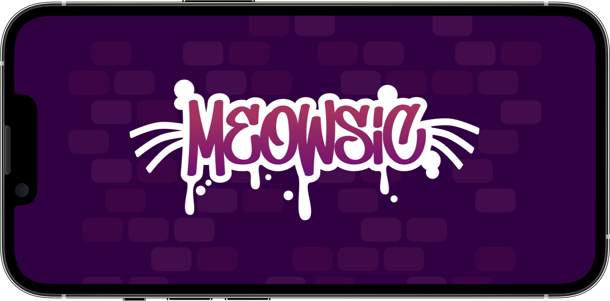

  

<strong>From strays to stars! 🌟</strong>

  An interactive musical playground where stray cats become a band.

  

  <a href="#about">About</a> ·
  <a href="#cbl">CBL</a> ·
  <a href="#visual-identity">Visual Identity</a> ·
  <a href="#illustrations">Illustrations</a> ·
  <a href="#screenshots">Screenshots</a> ·
  <a href="#running-the-project">Running the Project</a>

## About

**Meowsic** is an interactive musical experience that transforms stray cats into a band. Players choose their characters and create original tracks through different sound combinations.

Each cat brings a unique sound layer, allowing players to build compositions with their own rhythm and style. Combine characters, explore different instruments, and discover new ways to shape each track.

**Anyone can play with music — no technical knowledge required!**

 

| Challenge | Platform | Development |
| --- | --- | --- |
| Business Challenge | iPhone · iOS | 2 weeks |

  

## CBL

The project followed **Challenge Based Learning (CBL)**, exploring business concepts through a musical game.

### Engage

> **Big Idea:** Business in Games
>
> **Essential Question:** How can we learn about monetization, marketing, and metrics for apps focused on rhythm games?
>
> **Challenge:** How can we create a rhythm game for different audiences?

### Investigate

> **Problem / Opportunity Statement:** The team identified financial accessibility in mobile rhythm games as an opportunity to reach more players with an inclusive alternative.
>
> **Solution / Response Statement:** Create an accessible mobile game with playful musical elements for different age groups, using personalized cats as its visual theme.

### Act

> **App Statement:** Meowsic is a mobile music creation sandbox where players build tracks by combining cats, each with its own instrument and sound style.

  

## Visual Identity

Expressive cats, graffiti lettering, and colorful alleyways give Meowsic its playful personality. The visual identity brings together **Don Graffiti** and **SF Pro Rounded**, with palettes for light and dark appearances.

  

## Illustrations

Each character has its own look and musical role. Together, the cats turn different sound layers into a band full of personality.

  

  

## Screenshots

### Meet the band

  

  

### Make your track

  

### A different mood

  

  

## Technologies

| Technology | Role |
| --- | --- |
| Swift | Application and game logic |
| SwiftUI | Screens, navigation, and interface components |
| SpriteKit | Game scene and interactive cat characters |
| AVFoundation | Audio playback and sound layers |
| StoreKit | In-app review requests |

## Running the Project

1. Clone this repository and open `Meowdibox.xcodeproj` in Xcode on macOS.
2. Select the `Meowdibox` scheme and an iPhone simulator with iOS 18.0 or later.
3. Build and run with **⌘R**.

To run on a physical iPhone, select your development team in **Signing & Capabilities** and choose your connected device as the run destination.

The Xcode project and source folder retain the original **Meowdibox** name; the app is presented as **Meowsic**.

## License

See [LICENSE](LICENSE) for the code license (PolyForm Noncommercial 1.0.0) and [LICENSE-ASSETS.md](LICENSE-ASSETS.md) for the visual asset and brand terms.
